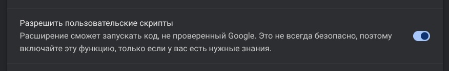
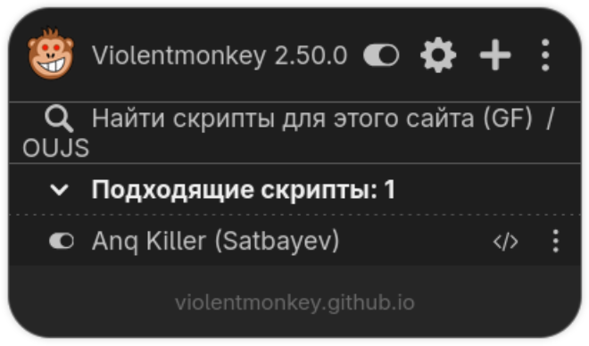
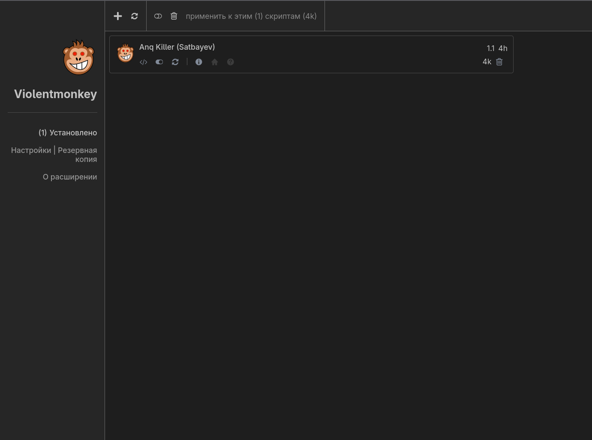
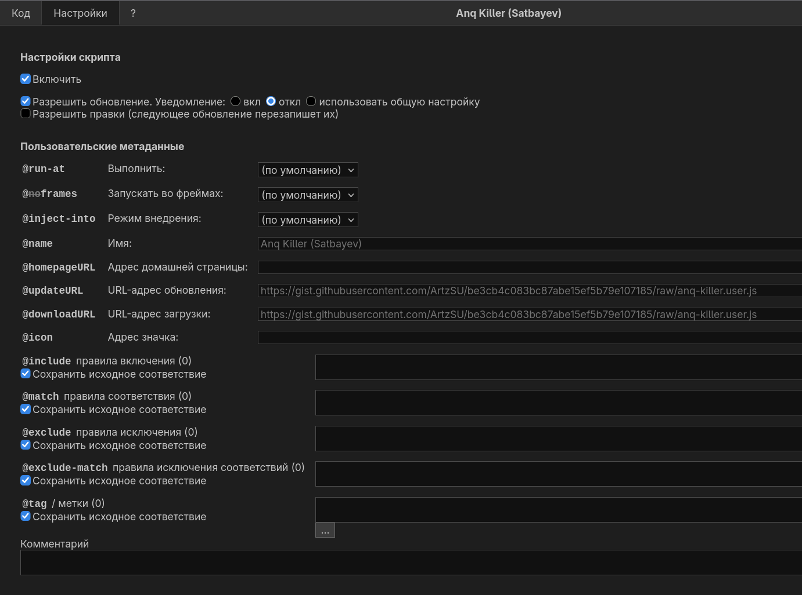

# SSO Anq Killer (Satbayev)

Юзерскрипт, который глушит обязательные анкеты на SSO Satbayev University:

- подменяет ответ запроса `GetAllAnqWeb` — сайт получает «анкет нет»;
- прячет модальное окно анкеты, если оно всё-таки успело появиться.

> ⚠️ Если университет поменяет API или вёрстку, скрипт может перестать работать до выхода новой версии.

---

## Где работает

| Платформа | Статус |
|---|---|
| Firefox (ПК) | ✅ |
| Chrome / Edge / Brave / Opera / Yandex / прочие Chromium (ПК) | ✅ (нужен доп. тумблер, см. шаг 2) |
| Android | ✅ Расширение Violentmonkey (надёжнее всего — Firefox для Android) |
| iPhone / iPad | ❌ Нет решения |

---

## Установка

### Шаг 1. Установите расширение Violentmonkey

Violentmonkey — менеджер пользовательских скриптов, он внедряет скрипт в страницу.

- Сайт разработчика: https://violentmonkey.github.io
- Firefox (ПК и Android): https://addons.mozilla.org/ru/firefox/addon/violentmonkey
- Chrome и Chromium-браузеры: https://chromewebstore.google.com/detail/violentmonkey/jinjaccalgkegednnccohejagnlnfdag

### Шаг 2. Только для Chrome / Chromium: разрешите пользовательские скрипты

Начиная с Chrome 138 расширениям нужно отдельное разрешение на запуск юзерскриптов. Без него Violentmonkey установится, но скрипты **не будут выполняться**.

1. Откройте в адресной строке `chrome://extensions`.
2. У Violentmonkey нажмите **«Подробнее»** (Details).
3. Включите тумблер **«Разрешить пользовательские скрипты»** (Allow User Scripts).



> В Firefox этот шаг не нужен.

### Шаг 3. Установите скрипт

Откройте ссылку:

**https://gist.githubusercontent.com/ArtzSU/be3cb4c083bc87abe15ef5b79e107185/raw/anq-killer.user.js**

Violentmonkey перехватит `.user.js` и покажет окно установки — нажмите **«Установить»** (Install).

> Если вместо окна установки открылся просто текст кода — Violentmonkey не установлен, отключён или (в Chrome) не включён тумблер из шага 2.

### Шаг 4. Проверьте

Зайдите на SSO Satbayev и нажмите на иконку Violentmonkey. В списке **«Подходящие скрипты»** должен быть **Anq Killer (Satbayev)** с включённым переключателем:



Анкета больше не должна появляться. Если появилась — обновите страницу (F5).

---

## Обновления

Новые версии публикуются в gist и подтягиваются автоматически — адрес обновления уже прописан в скрипте:

```
https://gist.githubusercontent.com/ArtzSU/be3cb4c083bc87abe15ef5b79e107185/raw/anq-killer.user.js
```

Violentmonkey сам периодически проверяет обновления. Чтобы обновить вручную — откройте панель Violentmonkey (⚙ в попапе) и нажмите ⟳ у скрипта:



Текущая версия показана справа от названия (например, `1.1`).

Проверьте, что в настройках скрипта (иконка `</>` → вкладка **«Настройки»**) стоит галочка **«Разрешить обновление»**:



> Галочку **«Разрешить правки»** не включайте, если не правите код сами: при следующем обновлении ваши изменения всё равно будут перезаписаны.

---

## Как временно выключить

- Нажмите на иконку Violentmonkey → переключатель рядом с **Anq Killer (Satbayev)** → обновите страницу.
- Или выключите Violentmonkey целиком переключателем в шапке попапа.

## Удаление

Панель Violentmonkey → иконка корзины 🗑 у скрипта.

---

## Если не работает

1. **Скрипта нет в «Подходящих скриптах»** — вы не на странице SSO, или скрипт не установлен/выключен.
2. **Chrome: скрипт есть, но ничего не происходит** — не включён тумблер «Разрешить пользовательские скрипты» (шаг 2). После включения обновите страницу.
3. **Анкета всё равно появилась** — обновите скрипт вручную (⟳) и страницу. Возможно, сайт поменялся — напишите автору. tg: @SatbayevUniversity.
